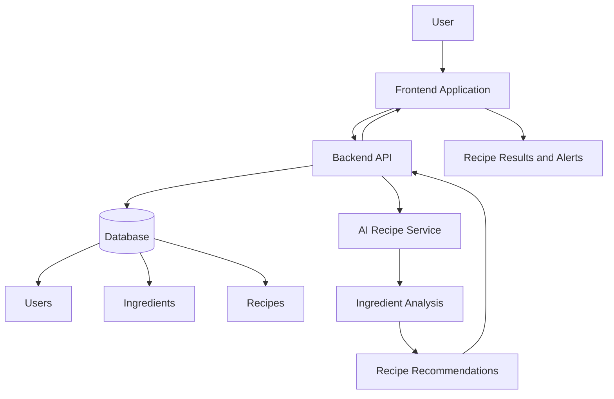

# Architecture Plan – FridgeMind

## 1. Project Overview

FridgeMind is an AI-powered food management application designed to reduce food waste.

Users can manage their refrigerator inventory, track expiration dates, and receive personalized recipe recommendations based on available ingredients.

## 2. High-Level Architecture

The application follows a simple client-server architecture.

### Main Components

**1. Frontend**
- Provides the user interface.
- Displays the ingredient inventory.
- Allows users to add, edit, and remove ingredients.
- Displays AI-generated recipes and expiration alerts.

**2. Backend API**
- Receives requests from the frontend.
- Validates user input.
- Manages ingredient and recipe data.
- Communicates with the AI service.
- Returns results to the frontend.

**3. Database**
- Stores user information.
- Stores ingredient inventory and expiration dates.
- Stores generated and saved recipes.
- Maintains relationships between entities.

**4. AI Recipe Service**
- Receives available ingredients from the backend.
- Analyzes ingredients and expiration dates.
- Generates recipe suggestions.
- Returns recipe names, ingredients, and preparation instructions.

## 3. Architecture Diagram

## 4. Main Application Workflow

### Ingredient Management
1. User opens the application.
2. User adds an ingredient and its expiration date.
3. Frontend sends the information to the backend.
4. Backend validates and saves the ingredient in the database.
5. Updated inventory is displayed.

### AI Recipe Generation
1. User requests recipe suggestions.
2. Backend retrieves available ingredients.
3. Backend sends ingredient information to the AI service.
4. AI analyzes the ingredients and prioritizes products close to expiration.
5. AI generates recipe suggestions.
6. Backend returns the results to the frontend.
7. User views the suggested recipes.

### Expiration Tracking
1. Backend checks ingredient expiration dates.
2. Ingredients close to expiration are identified.
3. Frontend highlights these ingredients.
4. Users can request recipes that use those ingredients.

## 5. Suggested Technology Stack

| Component | Suggested Technology |
|---|---|
| Frontend | HTML, CSS, JavaScript |
| Backend | Python with Flask |
| Database | SQLite |
| AI Integration | OpenAI API or another compatible AI API |
| Version Control | Git and GitHub |

## 6. MVP Scope

The first version will focus on:

- Adding and managing ingredients.
- Saving expiration dates.
- Generating AI-powered recipes.
- Displaying expiration alerts.
- Providing a simple and responsive interface.

Advanced features such as user authentication, barcode scanning, shopping lists, and detailed food waste analytics can be added in future versions.

## 7. Security and Reliability

- Validate user input before storing data.
- Keep API keys in environment variables.
- Handle API errors gracefully.
- Avoid exposing sensitive information.
- Provide clear error messages when a service is unavailable.

## 8. Future Improvements

- Barcode scanning for faster ingredient entry.
- Mobile application support.
- Personalized dietary preferences.
- Shopping list generation.
- Food waste statistics and progress tracking.
