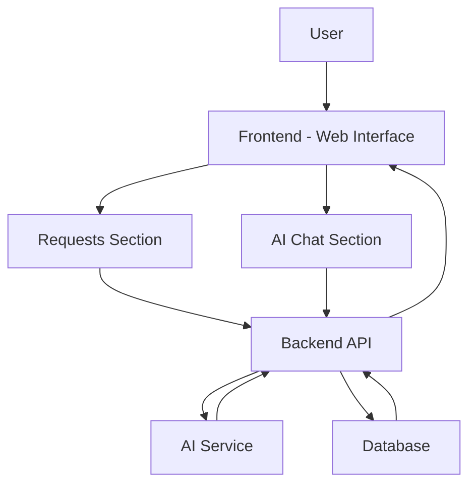

# System Architecture - SmartAdvisor

## Overview

SmartAdvisor is a web-based AI productivity assistant. Users interact with the application through a responsive interface. The backend processes requests and communicates with an AI service to generate responses.

## High-Level System Diagram

## Main Components

1. **Frontend:** Displays the user interface, forms, chat area, and navigation tabs.
2. **Backend API:** Receives user requests, validates input, and manages application logic.
3. **AI Service:** Processes user questions and generates AI-powered responses.
4. **Database:** Stores user requests, chat messages, and tasks.

## Main Workflow

1. The user opens SmartAdvisor.
2. The user submits a request or sends a message through the chat.
3. The frontend sends the information to the backend API.
4. The backend validates and processes the information.
5. If an AI response is needed, the backend communicates with the AI service.
6. The response is returned to the frontend and displayed to the user.
7. Relevant information is stored in the database.
